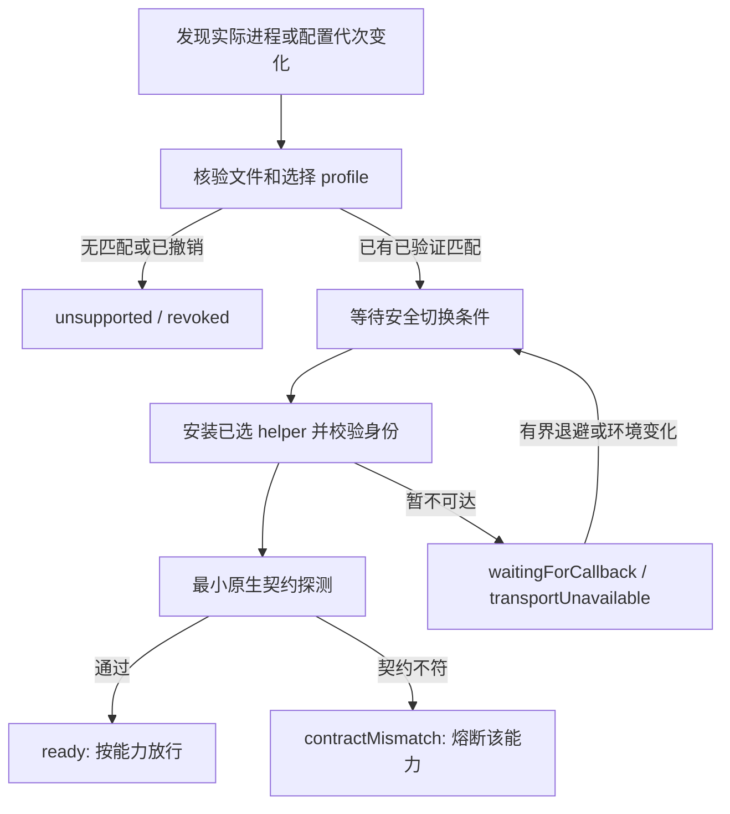

# Claude / Codex 桌面更新适配方案

状态：**P0/P1 已在 v0.8 实现并进行离线测试；P2/P3 尚未实现**。设计基线为 `eef6160`，以下保留目标设计；具体上线范围、命令、限制与验证缺口见 [v0.8 运维说明](update-operations.md)。旧目录生产服务尚未迁移。

目标：桌面升级后，已支持的构建自动恢复；未知构建能明确诊断并进入可重复的适配流程；活跃任务、消息、决策和线程权限保持可追溯。无法保证任意未来私有协议更新都无需适配。

## 1. 现状与具体缺口

当前已有：安装路径刷新、Codex pipe 重发现、Claude 重启/页面刷新附着、文件哈希门禁、helper 内容 revision、持久消息与决策，以及受保护会话的全局 MCP 重载阻断。

源码核对发现以下缺口，实施时需分别修复：

| 现状 | 更新时的影响 | 对应改动 |
|---|---|---|
| 两个 Python 监控在启动时读取单份 manifest，并预编译 payload | 换清单/源码后，运行中的监控仍可能使用旧内容 | 统一配置代次，按内容摘要失效并重建 payload |
| Codex 的 handled、Claude 的 active 按 PID 记住成功或失败 | 同 PID 下补齐兼容包后不会重新尝试 | 使用进程代次、配置摘要和重试状态作为键 |
| Codex 文件检查缓存仅以安装路径为键 | 相同路径被更新后可能复用旧判断 | 文件身份变化触发完整重验 |
| 安装包发现刷新目标路径，运行中旧进程可能仍来自旧包 | 容易把“已安装版本”和“正在运行版本”混在一起 | 分开记录 installedBuild 与 runningBuild |
| helper 重用主要比较 helperRevision | 同源码不同安装目录/token 代次可能误复用旧实例 | 增加 installationId、凭证代次和进程代次握手 |
| 当前执行预检主要覆盖创建及托管会话，原生其他入口各自判断 | 未托管发送、读取等路径缺少一致的能力门禁 | 所有桌面 RPC 经同一能力/代次检查 |
| 原生读取连续失败可触发 Claude 页面 reload | 协议改变可能被误当作瞬时故障并反复修复 | 错误分类、熔断、忙碌/保护检查，取消无条件刷新 |
| MCP 配置更新、helper 附着、worker 工具目录更新是不同步骤 | 配置已写或进程健康容易被误报为工具已可用 | 分层报告，并从真实 worker 验证目录 |
| Codex 存在 Webpack ID/类名，Claude identity 依赖 bundle 路径 | 打包和压缩变化仍会破坏定位 | 版本适配包 + 有界结构定位 + 契约验证 |

源码入口：[监控 Codex](../scripts/runtime/codex-mcp-autoattach.py)、[监控 Claude](../scripts/runtime/claude-autoattach.py)、[守护](../src/supervisor/bridge-supervisor.mjs)、[Codex 执行](../src/adapters/codex/codex-execution.mjs)、[运行时定位](../src/adapters/codex/codex-runtime.cjs)、[Claude 原生接口](../src/adapters/claude/claude-main-attach.cjs)。

## 2. 分为稳定核心和版本适配包

稳定核心负责 MCP/HTTP 公共契约、身份/路由、消息/决策持久化、调度、权限策略和恢复，不直接引用桌面 bundle/module ID。

每个版本适配包负责具体桌面的 transport、定位、原生参数/返回值映射、turn 边界和 helper 生命周期。Codex 的 pipe、settings、MCP 刷新、execution，Claude 的 LocalSessions、worker 身份、transcript，应分别声明能力；某项通过不能代表其他项也通过。

建议布局（以下为拟新增目录）：

```text
compat/
  schema.json
  catalog.json
  codex/<build-id>/<profile-id>.json
  claude/<build-id>/<profile-id>.json
adapters/
  codex/<adapter-id>/...
  claude/<adapter-id>/...
contracts/<app>/...
runtime/updates/
  state.json
  journal.jsonl
  reports/...
```

Git 只存自有适配代码、构建指纹、脱敏契约样例和验证摘要。安装包摘录、真实 transcript、诊断原件和凭证留在本机被忽略的目录。兼容目录中不得放桌面提取源码。

每份 profile 至少包含：schemaVersion、app、platform/arch、packageVersion、可选 runtimeVersion、EXE/chrome/ASAR 哈希、adapterId、adapterDigest、bridgeCoreApiVersion、定位策略、能力及其契约版本、测试证据摘要、撤销状态。能力的允许与否由已验证 profile 声明，不仅由调用方要求决定。

同一 adapter 可供多个**各自明确核验的构建**使用。版本区间、类名相似或 AST 相似只产生适配候选，不放行未知二进制。若新包只改包装版本、被依赖的完整文件哈希完全相同，可自动匹配已有支持记录并保留 observedVersion；明确区分包版本与 Electron runtimeVersion。

## 3. 统一构建、进程和安装身份

建立一个协调器，所有 worker 使用它发布的不可变选用结果，不各自决定兼容版本。

| 身份 | 定义和用途 |
|---|---|
| installationId | 首次安装生成的稳定 UUID，区分同机不同目录的桥接安装 |
| credentialEpoch | 凭证轮换代次，不包含 token 本身 |
| runningGeneration | app + PID + 进程创建时间 + 实际 executable 身份，防 PID 复用 |
| runningBuild | 从实际主进程路径关联并核验的桌面构建 |
| installedBuild | Appx 当前登记的安装构建；不直接覆盖 runningBuild |
| profileDigest / adapterDigest | 兼容声明和适配代码内容摘要 |
| activationEpoch | 一次原子激活的递增代次，约束并发和旧响应 |

helper 握手必须回报上述适用身份及 capability/contract 版本。不能只看 PID 或 helperRevision；发现 installationId、凭证代次或实际根目录不符时拒绝借用旧 helper，在空闲维护条件满足后再重绑。

新安装包已登记、旧桌面进程仍运行时：保留旧构建的已验证连接，报告 updatePending；不据此结束旧会话或启动第二个主实例。新进程实际出现后再选用它的构建。磁盘文件被原地替换、无法证明与已加载进程一致时进入 awaitingRestart，不将磁盘新哈希冒充运行进程身份。

文件检查缓存以进程代次、文件 ID/大小/mtime、profileDigest、adapterDigest 为索引。元数据只用于发现变化；实际匹配始终用完整哈希。每次新进程/附着和文件变化后重新核验，避免每条消息重复哈希整个 ASAR。

文件监听加周期性复核，兼容目录变化时失效“失败 PID”与负缓存；仅变化的 app/capability 重新评估。有限退避按 transport 状态控制，不因未知版本每秒反复尝试注入。

## 4. 更新状态机和能力门禁



状态按 app/capability 记录。需要切换 helper 时才进入 drain/waitingIdle；无需动旧 helper 的已验证只读能力可继续服务。

所有原生调用，包括直接 rawCall、未托管会话发送、settings、router、回传恢复，必须验证所需能力、进程代次与 activationEpoch。检查应覆盖派发前和 native 握手；切换时以派发锁避免检查通过后另一个 worker 更换代次。

“诊断”分三级：

1. 被动信息：进程/安装路径、文件哈希、已有 bridge 状态和本地队列。未知构建默认只做这一层及离线文件分析。
2. 已验证原生探测：通过版本门禁后，做工具 schema、会话读取与返回结构核对。会安装 helper/hooks 的步骤必须明确标为附着，不能叫纯只读。
3. 真实写入验收：消息、创建/唤醒、权限设置、决策恢复；只在已授权专用测试会话中运行。resume/warmSession、setModel、MCP reload、页面刷新也不能伪装成只读操作。

已有能力可独立降级，例如 readThread 通过、execution 未通过时开放读取而拒绝创建/权限修改。未知构建没有已验证 profile 时，不默认给它任何原生能力。某一端不可用不会关闭路由器或另一端已验证能力。

## 5. 更新时保留任务与消息

对受影响能力停止新的原生派发，保留本地收件箱、状态读取和已有持久记录。

| 操作状态 | 更新行为 |
|---|---|
| 未执行的请求 | 明确拒绝并返回 dispatchNotStarted，或由调用者显式选择排队 |
| 已持久化、尚未发送的队列项 | 置 blockedByUpdate，保留顺序、TTL、消息 ID，恢复后重验目标和配置 |
| 已发送且结果已持久化 | 使用已有结果，不重新执行 |
| 已发送但未收到可核验结果 | 保持 unknown，按精确 native 输入/turn ID 对账，不自动重发 |
| 决策已接收、来源端离线 | 区分 answerAccepted 与 resumePending；恢复后同会话续跑，不重复回答 |
| 来源端原会话忙碌/待审批 | 等待，不替用户批准，不改变模型、项目或权限 |

native 写入前持久化 dispatch intent，写入后记录进程代次、native 输入/turn ID 及结果。意图日志与管道写入之间仍有无法原子提交的崩溃窗口；不宣称端到端 exactly-once。不能证明未发送的请求保留 unknown。

对账不以“最近一条 final”替代原任务结果。先确认任务绑定的输入/turn；找不到时保持 unresolved。create 会话、设置、首条 prompt 是多个步骤，应分别记录，防止已有空会话时重新创建第二个。

恢复时重新检查原 threadId、项目/workspace、模型/effort 可用性、默认值及线程持久权限。请求不支持时返回配置不兼容，不静默换模型或降级完全权限。保持最近执行轮与下一轮权限的分开读回。

队列暂停不延长 TTL；若需要延长，由明确策略决定并留下事件。到期项发出本地可查询的到期记录。故障通知按 app+generation+error 分类去重，避免两端自动回报造成消息循环。

## 6. 安全切换、MCP 刷新与回退

选用 profile/adapter 的流程：校验候选包内容 → 暂停受影响派发 → 等待活动写入/相关原生会话空闲 → 保存切换日志 → 附着/探测 → 原子发布新 activationEpoch → 恢复队列。

不可同时在同一桌面进程内启用两份竞争 helper。准备候选包只做离线检查，不先启动第二套服务占用固定端口。所有 helper 注册/回调/缓存需有明确安装归属和可清理句柄；替换前检查 busy。进程内不能可靠清理时报告 awaitingRestart，不强行覆盖。

MCP 分为：配置已写、helper 已附着、server 已重连、具体 worker 已加载工具目录四个状态。工具目录摘要和 client revision 应由实际 worker 返回。

- 支持且已验证按会话重连时，只刷新空闲目标 worker。
- 必须全局 reload 时，保留现有 protected-threads 阻断规则，并等待所有受影响会话空闲。
- 暂不具备可靠忙碌检测或有待批准请求时不 reload，不用重启桌面端掩盖限制。
- Claude 页面 reload 与应用 restart 单独受调度约束；协议变化不会触发循环刷新。
- API 参数改成不兼容时，通过桥接契约版本明确报错，不能只更新工具描述后继续发送旧格式。

保留上一份已验证 adapter/profile 及其准确构建匹配。新候选失败时，只能回到仍支持**当前运行构建**的旧适配包；旧适配包只支持旧桌面时应保持 unsupported。桥接器不自动降级桌面应用。

回退只改 adapter/profile 的选用和进程内实例，不恢复旧消息队列快照，不删除新回执/决策，不重置全局权限或其他 MCP 配置。状态 schema 优先向后兼容；确需不可逆迁移时，把它从 adapter 切换中分离，并设置明确的 core 最低版本/回退边界。

## 7. 未知构建的适配流程

1. 自动生成脱敏诊断：实际进程路径/创建时间、包/runtime 版本、文件哈希、Python/Node/Frida 版本、选用 profile/adapter 摘要、错误阶段、旧 worker revision。原始 token、prompt 和 transcript 不入诊断包。
2. 静态分析安装包目录与模块形状，产生候选定位差异。优先用结构和导出行为定位，保留明确边界和唯一性检查；0 个或多个候选都拒绝自动选取。
3. Codex 分别核对 framing/tools schema、真实连接、会话管理器、turn/approval、MCP reload/identity。Claude 分别核对页面/API、LocalSessions 方法参数、session manager/worker PID 关联、transcript 的 user/tool-result/final 边界。
4. 通过离线契约测试后，在已授权测试环境里验证原生探测及真实往返、决策、配置、权限保留和重启恢复。
5. 产出与构建指纹、adapterDigest、core commit 绑定的证据，标记能力支持范围，再加入兼容目录。生产机不自动执行生成的未知 bundle 或修改全局配置来诱发回调。

新构建复用已核验协议也要登记它自身的指纹和证据。压缩类名、module ID、bundle 文件名可以变化；结构定位降低修复成本，但不能替代原生语义验收。

首版从本地 Git/离线兼容包导入，不依赖尚不存在的远端服务。后续如增加在线分发，使用独立签名的发布索引、允许的发布者密钥、内容摘要及撤销记录；校验完整包后再选用，不能下载即执行。各机器按实际构建独立选择，不把开发机的适配成功直接当成所有机器可用。

## 8. 运维接口与错误

以下列出原设计的维护接口；v0.8 已提供 doctor、compat list/import/plan/activate/rollback/recover 和 HTTP compatibility，命令前缀为 desktop-agent-bridge，具体参数见运维说明：

```text
bridge doctor [--app codex|claude] [--passive|--probe]
bridge compat list
bridge compat import <local-package>
bridge compat plan --app <app>
bridge compat activate --app <app> --profile <id> --when-idle
bridge compat rollback --app <app>
GET /v1/compatibility
```

被动 doctor 是默认模式；probe 只能操作已验证构建。plan 显示受影响能力、进程/worker、是否要 reload/restart、保护阻断和回退条件。activate 不绕过 busy/protected 状态，等待不是同意重启。客户端重启后可从持久日志恢复切换状态。

状态字段至少包括 installedBuild、runningBuild、generation、profileDigest、adapterDigest、capabilities、toolCatalogDigest、lastProbeAt、lastSuccessAt、updatePhase、blockedReason 和 recommendedAction。推荐动作只描述可选维护步骤，不自动执行有影响的动作。

错误分类建议：

| code | 行为 |
|---|---|
| `DESKTOP_NOT_RUNNING` / `TRANSPORT_UNAVAILABLE` | 明确暂不可达，按连接策略恢复；不重放写入 |
| `BUILD_UNSUPPORTED` / `PROFILE_REVOKED` | 不重复附着，等待有效兼容包 |
| `ADAPTER_STALE` / `CONFIG_EPOCH_CHANGED` | 失效相关缓存并重新选用；未发出请求可恢复 |
| `NATIVE_CALLBACK_PENDING` | 等待合法回调，有界退避；不 touch 用户配置 |
| `CONTRACT_MISMATCH` | 熔断对应能力，生成诊断 |
| `IDENTITY_MISMATCH` | 拒绝旧目录/旧凭证/错误进程实例 |
| `REFRESH_DEFERRED_BUSY` / `REFRESH_DEFERRED_PROTECTED` | 保留旧可用能力，报告待维护 |
| `DISPATCH_OUTCOME_UNKNOWN` | 对账，不自动重发 |

通用响应附 dispatchStage（notStarted / intentRecorded / sent / confirmed）及已知的 capability、build、generation、profile 摘要。不能确认 notStarted 时不得用该标记帮助调用者重试。

## 9. 验收与实施顺序

| 阶段 | 范围 | 必须验收 |
|---|---|---|
| P0：统一状态和失效 | running/installed 分离、进程代次、配置摘要、typed error、失败缓存失效、无条件 reload 改为受控恢复、统一能力门禁 | 同 PID 补清单可重新评估；新安装包不干扰旧活跃进程；所有写入入口被阻断 |
| P1：可重复维护 | 被动 doctor、profile catalog、已知构建选择、helper 安装身份、idle 切换日志与回退、worker revision 可见 | 断电/守护重启可恢复切换；错安装目录拒绝；不重复派发 |
| P2：适配效率 | 结构定位候选、版本契约 fixtures、授权 canary、证据绑定、多机器部署包 | 两端各保留至少两套脱敏历史契约；新旧构建切换和未知构建拒绝矩阵通过 |
| P3：可选分发 | 签名索引、撤销、缓存与渠道 | 包被篡改/撤销/断网时保持可用的已核验匹配或明确停用 |

P0/P1 先做，才能直接解决“清单改了仍用旧状态”“反复重启却不恢复”“旧 helper 指向旧目录”等实际维护问题。版本结构定位和远程自动分发放在其后。

离线测试矩阵至少覆盖：同 PID 新 profile、PID 复用、同路径换字节、两包并存、原地替换、旧 root/token 代次、profile 撤销、每个切换阶段崩溃、协议字段变化、schema 不支持、MCP 工具目录过期、过期队列与已回答决策。

真实验收使用已有专用会话：两端分别升级/重启、页面刷新、MCP 重连、双向消息与决策、项目/model/effort 读回、完全权限的下一轮与实际轮读回、原策略恢复。活动任务、待批准请求和 protected 会话必须证明未被重启/刷新；unknown 必须证明没有重复派发。

拟定运行目标，实施后测量再决定是否作为 SLA：安装/进程变化 60 秒内被发现；兼容目录变化 5 秒内重新评估；已知构建在获得合法回调且空闲后 60 秒内完成附着/探测。未知构建、受保护会话和 pending approval 不承诺自动恢复时间，应立即暴露阻断原因。

独立仓库 v0.8 已实现 P0/P1 的离线可验证路径；结构定位、历史构建 canary 和远程签名分发仍待 P2/P3。原目录生产服务仍运行 v0.7，真实升级验收不能用本设计或离线测试替代。
